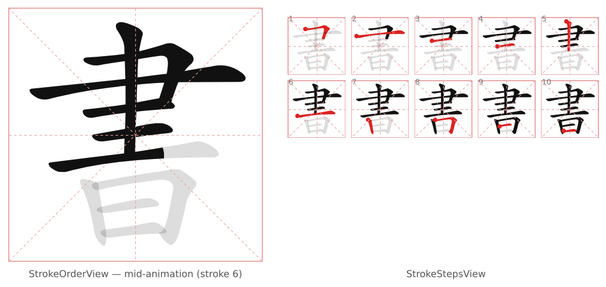

# HanziStroke

Native SwiftUI stroke-order rendering for Chinese characters (simplified and traditional), using the
[hanzi-writer-data](https://github.com/chanind/hanzi-writer-data) set (Make Me a Hanzi, ~9,500 characters).
iOS 17 / macOS 14, no dependencies.



## Use

Add the folder as a local Swift package (File ▸ Add Package Dependencies ▸ Add Local…), then:

```swift
import HanziStroke

// Quick start: a full demo screen
HanziStrokeDemo()

// Or the pieces
let c = try await HanziDataLoader.fromCDN("書")          // or HanziDataLoader.fromBundle("書")
StrokeOrderView(character: c, radicalColor: .blue)      // animated; tap to replay
StrokeOrderView(character: c, speed: 0.5, loops: true)
StrokeStepsView(character: c, panelSize: 56)            // one panel per stroke, start dot on the new stroke
```

## How it draws

Each stroke has a filled outline and a median (the brush path). Animation clips to the outline and
strokes a 180-unit-wide line along the median, trimmed to the current progress — the same technique
Hanzi Writer uses. Pacing follows Hanzi Writer: `(medianLength + 600) / 3000` s per stroke at speed 1.

Data is y-up with the top at y = 900; `HanziCharacter` flips it to SwiftUI's top-left origin in a
1024 × 1024 box.

## Offline data

`npm pack hanzi-writer-data@2.0.1`, extract, and add the JSON files to your app as a folder reference
named `hanzi-data` (~47 MB for all; copy only the characters you need to keep it small). Then use
`HanziDataLoader.fromBundle(_:)`.

## Taiwan stroke order

The data follows **PRC** stroke order. For characters where Taiwan's MOE order differs, use
`character.reordered([...])` to reorder strokes. That fixes order only, not stroke shape or direction.
Check the MOE site (stroke-order.learningweb.moe.edu.tw) for the reference order.

## License

Code: MIT (see `LICENSE`). Character data: Arphic Public License (see `ARPHICPL.TXT`, also shipped in the npm package);
ship that license with the data if you bundle it.

Not compiled in the environment that produced it — run the tests in Xcode first.

## Demo app

`Demo/HanziStrokeDemoApp.xcodeproj` is a small iOS app that uses this package as a local dependency:
a list of sample characters (simplified and traditional), a field to look up any character, and a
detail screen with the animation, replay, speed/loop/radical/grid controls and the step chart.
Open it in Xcode, pick a simulator, and run. It loads stroke data from the CDN, so it needs a network connection.
